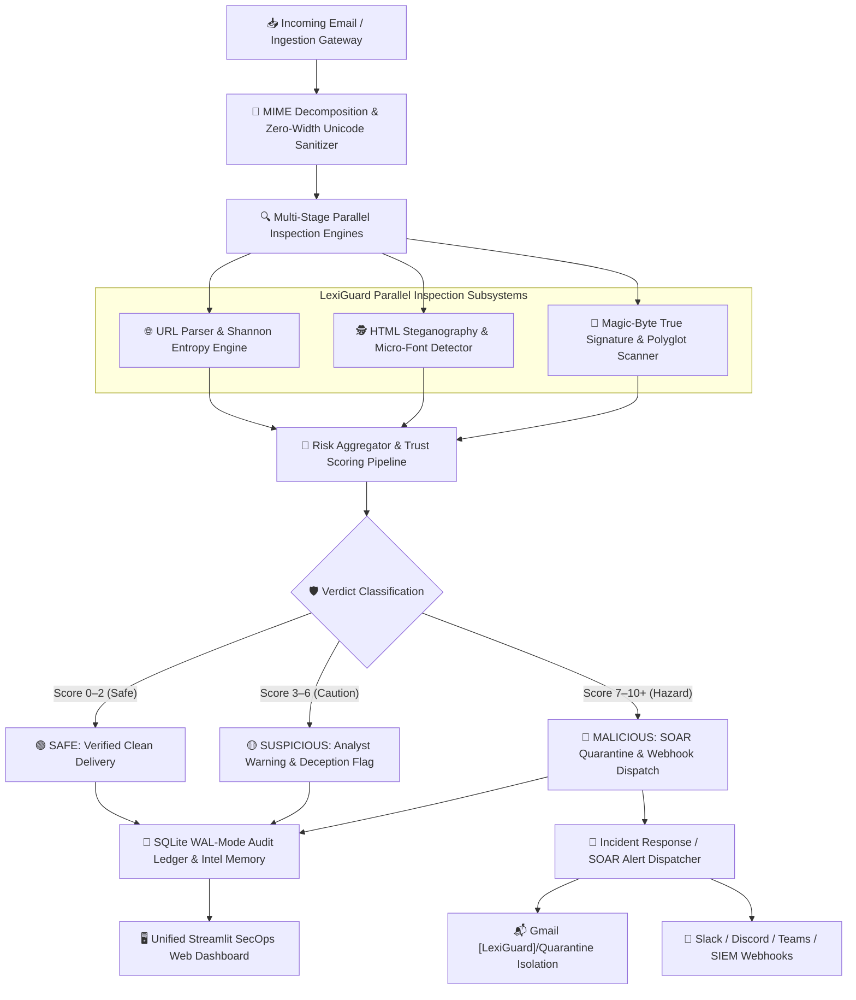
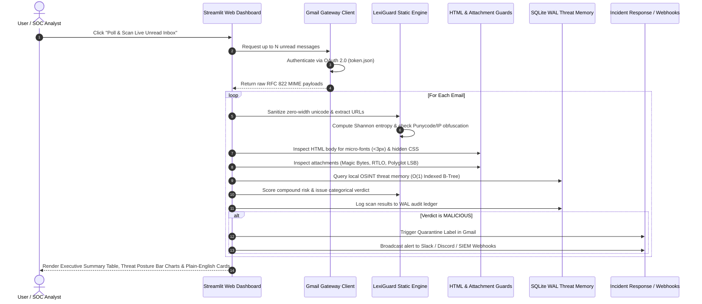

# 🛡️ LexiGuard Enterprise Security Gateway

[](https://www.python.org/)
[]()
[]()
[]()
[]()

> **LexiGuard** is a high-performance, on-demand, cross-platform enterprise security gateway and email threat analysis engine. Built for cybersecurity engineers, SOC analysts, and everyday business users, LexiGuard inspects incoming emails and URLs for phishing lures, hidden HTML steganography, deceptive zero-width unicode, malicious executable attachments, and binary polyglot evasions—all backed by a high-concurrency WAL-mode SQLite threat memory ledger and real-time SOAR incident response webhooks.

---

## 📑 Table of Contents
1. [System Architecture & Data Flow](#-system-architecture--data-flow)
2. [File Hierarchy & Repository Architecture](#-file-hierarchy--repository-architecture)
3. [Technologies, Libraries & Methods](#-technologies-libraries--methods)
4. [End-to-End User Manual & Quickstart](#-end-to-end-user-manual--quickstart)
   - [Step 1: Prerequisites & Environment Setup](#step-1-prerequisites--environment-setup)
   - [Step 2: Category B Configuration (Secrets & Credentials)](#step-2-category-b-configuration-secrets--credentials)
   - [Step 3: Launching LexiGuard](#step-3-launching-lexiguard)
   - [Step 4: Using the Application](#step-4-using-the-application)
5. [Automated Testing & Security Validation](#-automated-testing--security-validation)

---

## 🏗️ System Architecture & Data Flow

LexiGuard operates on a **Defense-in-Depth Zero-Trust Pipeline**. When incoming messages arrive via Gmail OAuth or gateway simulation, each message undergoes 7 specialized inspection stages before reaching the analyst dashboard:



### Detailed Sequence Diagram: Email Inspection Lifecycle



---

## 📂 File Hierarchy & Repository Architecture

The repository consists of **54 production files** (forming the complete 56-file enterprise system alongside the user's local `.env` and `credentials.json`), structured cleanly into modular sub-packages:

```
LexiGuard/
├── app.py                          # Unified multi-tab Streamlit SecOps dashboard
├── run.py                          # Cross-platform single-command launcher
├── requirements.txt                # Pinned production Python dependencies
├── pyproject.toml                  # Pytest runner & package configuration
├── .gitignore                      # Git exclusion rules for private keys & databases
├── .env.example                    # Blueprint template for cloud API keys & webhooks
├── credentials.json.example        # Blueprint template for Google OAuth Desktop Client
├── README.md                       # Master architecture documentation & manual
│
├── lexiguard/                      # Core Intelligence & Scanning Framework
│   ├── __init__.py                 # Dynamic environment variable loader & package exports
│   │
│   ├── core/                       # Static Parsing & Scoring Engine
│   │   ├── __init__.py
│   │   ├── parser.py               # RFC 3986 URL parsing, Punycode, IP format decoders
│   │   ├── features.py             # Quantitative metrics, Shannon entropy, policy rules
│   │   └── scorer.py               # Compound risk scoring engine (0-10+ scale)
│   │
│   ├── evasion/                    # Steganography & Evasion Countermeasures
│   │   ├── __init__.py
│   │   ├── html_guard.py           # Microscopic fonts (<3px), hidden CSS, anchor spoofing
│   │   └── unicode_guard.py        # Zero-width spaces, homoglyphs, bidirectional text
│   │
│   ├── gateway/                    # Ingestion Gateway & Binary Scanners
│   │   ├── __init__.py
│   │   ├── attachments.py          # Magic-byte file signatures, RTLO, macro detection
│   │   └── gmail_client.py         # Cross-platform Google OAuth 2.0 inbox polling
│   │
│   ├── intel/                      # Cloud Threat Intelligence & Sandbox Connectors
│   │   ├── __init__.py
│   │   ├── virustotal.py           # VirusTotal v3 API connector (URLs & file hashes)
│   │   ├── google_webrisk.py       # Google Web Risk API connector
│   │   ├── hybrid_analysis.py      # CrowdStrike / Hybrid Analysis v2 connector
│   │   └── stego_api.py            # Deep polyglot analyzer (trailing payloads & LSB)
│   │
│   ├── db/                         # Persistence & Threat Intelligence Memory
│   │   ├── __init__.py
│   │   ├── database.py             # WAL-mode SQLite ledger (scans, intel, quarantine)
│   │   └── seed_intel.py           # "No-zero-start" OSINT threat bootstrapper
│   │
│   ├── reports/                    # Compliance & Reporting Exporter
│   │   ├── __init__.py
│   │   └── exporter.py             # RFC 4180 CSV & executive HTML audit report generator
│   │
│   ├── response/                   # Automated Incident Response (SOAR)
│   │   ├── __init__.py
│   │   ├── responder.py            # Quarantine manager & action execution engine
│   │   └── webhooks.py             # Slack Block Kit, Discord Embeds, Teams, SIEM
│   │
│   └── ui/                         # User Experience & Translation Layer
│       ├── __init__.py
│       └── translator.py           # Plain-English Threat Translator for non-technical users
│
└── tests/                          # Automated Offline Test Suite (214 Tests)
    ├── __init__.py
    ├── test_parser.py              # URL decomposition & RFC compliance tests
    ├── test_features.py            # Quantitative metric & entropy tests
    ├── test_scorer.py              # Compound risk scoring & verdict tests
    ├── test_html_guard.py          # HTML steganography & micro-font tests
    ├── test_attachments.py         # Binary magic-byte & RTLO tests
    ├── test_gateway.py             # Gmail MIME decoding tests
    ├── test_database.py            # WAL-mode SQLite ledger tests
    ├── test_seed_intel.py          # OSINT threat bootstrapper tests
    ├── test_exporter.py            # CSV & HTML compliance report tests
    ├── test_responder.py           # Quarantine & webhook broadcaster tests
    ├── test_translator.py          # Plain-English translator tests
    ├── test_stego_api.py           # Polyglot & steganography analysis tests
    ├── test_api_keys.py            # API key security & leak prevention tests
    └── test_fuzz_matrix.py         # Combinatorial fuzzing test suite
```

### File Classification Scheme for Version Control

| Category | Description | Examples | Action for GitHub |
| :--- | :--- | :--- | :--- |
| **Category A** | **Public Code & Assets** | All Python files (`lexiguard/`, `tests/`, `app.py`, `run.py`), `requirements.txt`, `pyproject.toml`, `README.md`, `.gitignore`, `.env.example`, `credentials.json.example` | **Upload to GitHub** |
| **Category B** | **Private Secrets & Local State** | Live OAuth credentials (`credentials.json`), OAuth tokens (`token.json`), private API keys (`.env`), audit database (`lexiguard.db`) | **Strictly Excluded by `.gitignore`** |
| **Category C** | **Caches & Virtual Environments** | `venv/`, `__pycache__/`, `.pytest_cache/`, `*.pyc`, `app_2.py` (temporary backup) | **Strictly Excluded by `.gitignore`** |

---

## 🛠️ Technologies, Libraries & Methods

| Layer / Subsystem | Technology / Library | Version | Purpose & Architectural Method |
| :--- | :--- | :--- | :--- |
| **Runtime Language** | **Python** | `3.10+` | Core execution environment using modern typing (`typing.Any`, `Pathlib`, `dataclasses`). |
| **Frontend UI** | **Streamlit** | `^1.30.0` | Reactive SecOps analyst dashboard with session-state caching and dynamic components. |
| **Data Visualization** | **Plotly & Altair** | `^5.18.0` / `^5.2.0` | Interactive threat distribution charts and responsive hazard level meters. |
| **DOM Parsing** | **BeautifulSoup4** | `^4.12.0` | In-depth HTML AST traversal for detecting micro-fonts, hidden CSS styles, and spoofed anchors. |
| **Mail Ingestion** | **Google API Client** | `^2.110.0` | Official Google OAuth 2.0 and Gmail REST API library (`google-api-python-client`, `google-auth-oauthlib`). |
| **Persistence Engine** | **SQLite3 (WAL Mode)** | Native | High-concurrency local database running in **Write-Ahead Logging** mode with zero external server dependencies. |
| **Data Processing** | **Pandas** | `^2.1.0` | Tabular data manipulation for executive summaries and audit export formatting. |
| **Network & Webhooks** | **Requests & Urllib3** | `^2.31.0` | Authenticated HTTPS dispatch for cloud threat intelligence and SIEM/SOAR webhooks. |
| **Testing Framework** | **Pytest** | `^8.0.0` | Comprehensive test harness executing 214 automated test cases completely offline. |

---


## 📖 End-to-End User Manual & Quickstart

### Step 1: Prerequisites & Environment Setup

#### Requirements
- **Operating System**: Ubuntu / Debian Linux, macOS (Apple Silicon or Intel), or Windows 10/11 (64-bit).
- **Python**: Version `3.10`, `3.11`, or `3.12`.

#### 1. Clone or Download the Repository
```bash
git clone https://github.com/your-username/LexiGuard.git
cd LexiGuard
```

#### 2. Create and Activate a Virtual Environment
- **On Linux / macOS:**
  ```bash
  python3 -m venv venv
  source venv/bin/activate
  ```
- **On Windows (PowerShell):**
  ```powershell
  python -m venv venv
  .\venv\Scripts\Activate.ps1
  ```

#### 3. Install Required Dependencies
```bash
pip install -r requirements.txt
```

---

### Step 2: Category B Configuration (Secrets & Credentials)

LexiGuard works **100% out-of-the-box** in offline heuristic mode even with no API keys. To connect live Gmail or external cloud intelligence, configure the two blueprint files:

#### A. Environment Configuration (`.env`)
1. Copy the provided `.env.example` file to `.env`:
   - **Linux / macOS:** `cp .env.example .env`
   - **Windows:** `copy .env.example .env`
2. Open `.env` in any text editor and paste your optional API keys:
   ```ini
   VT_API_KEY=your_virustotal_key_here
   GOOGLE_WEBRISK_API_KEY=your_google_webrisk_key_here
   LEXIGUARD_SLACK_WEBHOOK=https://hooks.slack.com/services/...
   ```

#### B. Google Cloud OAuth Credentials (`credentials.json`)
To enable the live Gmail polling gateway:
1. Open [Google Cloud Console](https://console.cloud.google.com/apis/credentials).
2. Create an **OAuth 2.0 Client ID** with **Application type: Desktop app**.
3. Download the JSON credentials file and save it in the project root as `credentials.json` (or use [`credentials.json.example`](file:///C:/LexiGuard/credentials.json.example) as structural reference).
4. *(Alternatively, you can launch the app and drag-and-drop the JSON file directly into the Web UI!)*

---

### Step 3: Launching LexiGuard

Start LexiGuard with a single command:

```bash
python run.py
```
*(Or alternatively: `streamlit run app.py`)*

The launcher automatically:
1. Validates your Python runtime environment.
2. Initializes the WAL-mode SQLite database (`lexiguard.db`).
3. Bootstraps the local threat memory with curated OSINT threat signatures.
4. Opens the SecOps Web Dashboard in your default web browser at `http://localhost:8501`.

---

### Step 4: Using the Application

The web dashboard is divided into dedicated operations tabs:

1. **Tab 1: Live Static Analysis Engine**
   - Paste any suspicious URL, IP, or raw link.
   - Click **Run Static Decomposition** to view lexical features, Shannon entropy, policy flags, and risk score.
   - Use the **Plain-English Threat Translator** for a human-readable risk explanation.

2. **Tab 2: Anti-Evasion & HTML Steganography Guard**
   - Paste raw HTML email code to inspect for hidden microscopic text ($<3\text{ px}$), camouflaged text matching background colors, and deceptive hyperlink anchors.

3. **Tab 3: Binary & Attachment Scanner**
   - Upload any email attachment (`.pdf`, `.png`, `.docx`, `.exe`, `.zip`).
   - Verifies the **true magic-byte file signature**, checks for double-extension lures (e.g. `invoice.pdf.exe`), and flags Right-to-Left Override (RTLO) unicode attacks.

4. **Tab 4: Live Gmail Ingestion Gateway**
   - Adjust the **Max unread emails to ingest** slider (e.g. 10 or 20 emails).
   - Click **⚡ Poll & Scan Live Unread Inbox**.
   - Review the **Executive Summary Table**, high-contrast **Threat Distribution Chart**, and click any email card to inspect verified safe and flagged hyperlinks.
   - Switch between **Page 1**, **Page 2**, or **View All** using the view selector.
   - *(No credentials yet? Click **🧪 Run Gateway Simulation** to test with pre-built synthetic attacks!)*

5. **Tab 5: Incident Response & Webhooks (SOAR)**
   - Test automated Gmail isolation: moves malicious emails into `[LexiGuard]/Quarantine`.
   - Dispatch test incident alerts to Slack, Discord, Microsoft Teams, or enterprise SIEM endpoints.

6. **Tab 6: Threat Memory & Compliance Exporter**
   - View historical scan logs and search threat signatures.
   - Export official compliance reports in **RFC 4180 CSV** or **Executive HTML** format with one click.

---

## 🧪 Automated Testing & Security Validation

Run the offline automated test suite at any time:

```bash
pytest tests -v
```

All 214 tests run in under 4 seconds completely offline, validating RFC parser compliance, risk scoring matrices, HTML evasion guards, attachment signature verifiers, and incident response dispatchers.
